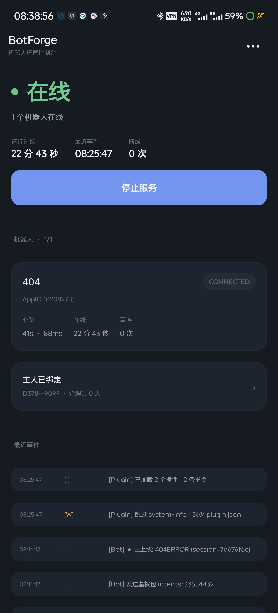
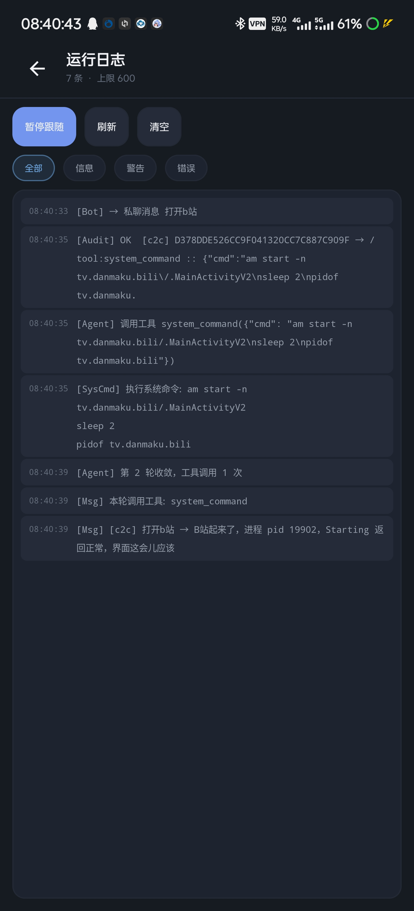
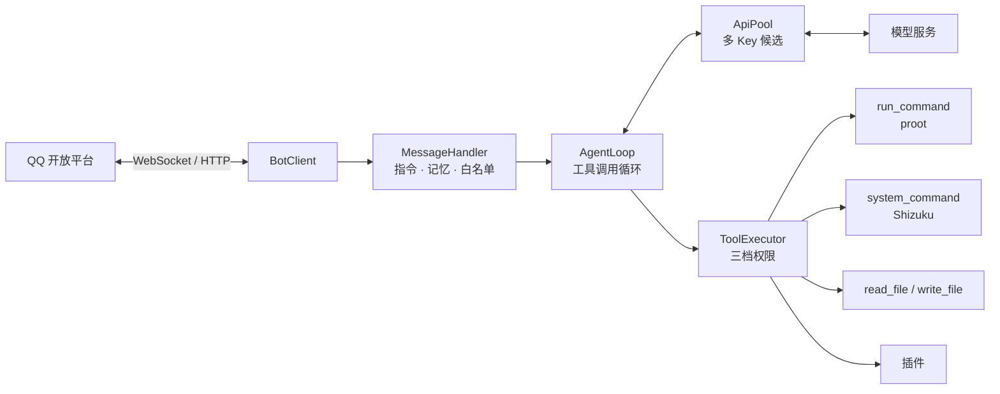

<div align="center">


# BotForge

**把手机变成一台常驻的 QQ 机器人，并且让模型真的能操作它。**

无需服务器 · 无需 root · 接入 QQ 官方机器人 · 内置 Linux 环境

[](https://github.com/a2006-dev/BotForge/releases)
[](https://github.com/a2006-dev/BotForge/actions/workflows/build.yml)
[](LICENSE)


[](https://qm.qq.com/q/1012917975)

[快速开始](#快速开始) · [能做什么](#能做什么) · [安全模型](#安全模型) · [架构](#架构) · [构建](#构建) · [路线图](#路线图) · [文档](#文档)

<br/>




</div>

---

## 为什么做它

多数 QQ 机器人方案需要一台一直开着的电脑或服务器。BotForge 把整套东西放进手机里：

- **机器人在手机上跑。** 连接 QQ 开放平台的官方机器人接口，用 AppID / AppSecret，不登录你的个人 QQ。
- **模型能动手。** 在 QQ 里让模型执行命令、读写文件，甚至借助 Shizuku 操作手机本身（打开应用、改设置、截图）。
- **默认克制。** 每个工具都有独立开关和三档权限；工具调用只对私聊开放。

> 它不是云崽或 AstrBot 的移植版。它的取舍很明确：以官方接口为边界，换取不依赖个人号、不依赖服务器、能直接碰到手机。

---

## 一次对话长什么样

以下截自实测运行日志：

```text
你    ▸ 打开b站

[Bot]     → 私聊消息 打开b站
[Agent]   调用工具 system_command({
             "cmd":"am start -n tv.danmaku.bili/.MainActivityV2\nsleep 2\npidof tv.danmaku.bili"
           })
[SysCmd]  执行系统命令: am start -n tv.danmaku.bili/.MainActivityV2
          sleep 2
          pidof tv.danmaku.bili
[Audit]   OK [c2c] D378…909F → /tool:system_command
[Agent]   第 2 轮收敛，工具调用 1 次

Bot   ▸ B站起来了，进程 pid 19902，Starting 返回正常
```

模型自己写了"启动 → 等待 → 校验进程"三步，跑完才回复。`[Audit]` 那一行是审计记录。

---

## 能做什么

<table>
<tr>
<td width="50%" valign="top">

### 机器人
- 多机器人并存，各自独立的 AppID / 人格 / 模型
- 官方 WebSocket 接入，断线按指数退避加抖动重连
- 主人 / 管理员两级权限，主人用一次性验证码绑定
- 群白名单、单群开关与冷却
- 前台服务、守护服务、开机自启，可选 Shizuku 保活

</td>
<td width="50%" valign="top">

### 模型
- 兼容 OpenAI Chat Completions 的服务，包括自建与中转
- 多 Key 候选池，失败自动切换下一条
- 工具调用循环（function calling），多轮收敛
- 可选联网搜索；支持图片输入
- 人格系统：系统提示、回复风格、记忆开关

</td>
</tr>
<tr>
<td width="50%" valign="top">

### 执行
- `run_command`：内置 Linux 用户空间（proot）里执行命令，常驻 shell，命令间复用
- `system_command`：经 Shizuku 以 ADB 身份执行（`am`、`pm`、`settings`、`input`、`screencap`）
- `read_file` / `write_file`
- 插件：在 QQ 里用 `/指令` 触发，带白名单与审计

</td>
<td width="50%" valign="top">

### 管控
- 工具按"包"分组，整包可关
- 每个工具三档：允许 / 需确认 / 禁用
- 设置页即改即生效
- 运行日志：收发、模型调用、工具调用、审计、错误
- `diagnose_terminal`：一键把环境诊断落盘

</td>
</tr>
</table>

---

## 快速开始

需要：Android 8.0+、`arm64-v8a` 设备。开发与实测设备为 vivo（Android 16，无 root）。

**1. 安装**
从 [Releases](https://github.com/a2006-dev/BotForge/releases) 下载最新 APK。安装包由 CI 构建并签名。

**2. 创建机器人**
在 QQ 开放平台创建机器人，拿到 AppID 与 AppSecret，在 BotForge 里新建机器人并填入。

**3. 配置模型**
填入接口地址、Key 与模型名，并做一次模型连通性探测确认可用。

**4. 绑定主人**
在 App 里生成 8 位验证码（5 分钟内有效，一次性），然后在 QQ 里私聊机器人：

```text
/绑定主人 ABCD2345
```

App 里有「复制命令」按钮，直接复制整行发送即可。

**5. 按需开启执行能力**

<details>
<summary><b>内置 Linux 环境（run_command）</b></summary>

在 设置 → 终端环境 中安装。首次会解包用户空间，之后常驻复用。
环境不可用时，让机器人调用 `diagnose_terminal`，诊断结果写入 `/sdcard/Download/bf_terminal_diag.txt`。

</details>

<details>
<summary><b>系统控制（system_command）</b></summary>

需要先安装并启动 [Shizuku](https://shizuku.rikka.app/)，再在 BotForge 里授权。未授权时该工具会如实返回"未获授权"，不会假装成功。

</details>

<details>
<summary><b>保活</b></summary>

在 权限 页按引导授予：电池优化白名单、悬浮窗、通知。国产 ROM 请另外在系统设置里允许自启动与后台运行。

</details>

---

## 安全模型

这个项目的能力很大，所以边界要写清楚。

**三档权限**

| 档位 | 对模型 | 当前行为 |
| --- | --- | --- |
| 允许 | 可见、可调用 | 直接执行 |
| 需确认 | 可见 | **尚未接通**：调用会直接返回"确认功能尚未开放" |
| 禁用 | 不可见 | 模型不知道它存在 |

> [!WARNING]
> 当前版本各工具默认均为「允许」，包括 `system_command` 与插件执行。请在「工具包」设置页按需收紧，尤其是 `system_command`。

**已经有的约束**

- 工具调用只在私聊开放，群聊里模型不会自主执行工具。
- 主人绑定为一次性验证码，5 分钟过期。
- API Key 等敏感配置优先保存在 Android Keystore 托管的加密存储中（个别 ROM 的 Keystore 异常时会降级为明文，设置页会显示当前状态）。
- 每次工具调用写审计日志：谁、在哪个会话、调了什么、参数是什么。

**需要你知道的边界**

- `run_command` 在 proot 容器里运行，**不是强隔离沙箱**。共享存储（`/sdcard`）以读写方式挂入容器，命令可以修改其中的文件。
- 模型的输入里可能含网页搜索结果等不可信文本，存在提示词注入风险；不建议在同一个机器人上同时打开联网搜索和高危工具。
- 无 root 的设备上，应用私有目录依赖 Android 自身的应用隔离；已 root 的设备上这层保护可被绕过。
- 授予 Shizuku 权限等于允许 BotForge 以 ADB 身份行事，请自行判断。
- `screencap` 能把屏幕截到本地，但**回传图片到 QQ 尚未实现**（见路线图）。

---

## 架构



```text
app/src/main/java/com/ajx/botforge/
├── qq/        连接、消息分发、指令、QQ 接口
├── ai/        模型调用、多 Key 池、记忆、联网搜索
│   └── tool/  工具定义、工具包与权限、执行入口
├── term/      proot 环境、rootfs 解包、隐藏执行器
├── service/   前台服务、守护、开机自启、保活
├── plugin/    插件注册、白名单、审计
├── data/      配置、鉴权、加密存储、日志
└── ui/        Jetpack Compose 界面
```

---

## 构建

要求：JDK 17+、Android SDK（`compileSdk 34`）。

```bash
git clone https://github.com/a2006-dev/BotForge.git
cd BotForge
./gradlew assembleDebug       # 产物在 app/build/outputs/apk/debug
./gradlew testDebugUnitTest   # 单元测试
```

Release 包由 CI 构建：推送 `v*` 标签会触发构建并把 APK 发布到 Releases。
签名密钥不随源码分发。

---

## 路线图

> 计划中，不构成承诺。

- [ ] 「需确认」档的真正确认流程（QQ 内确认 / 通知栏按钮）
- [ ] 默认权限收紧，高危工具默认需确认
- [ ] 向 QQ 回传图片（如截图）
- [ ] 记忆升级：本地检索、上下文压缩
- [ ] 插件索引与一键安装
- [ ] 插件安装前展示权限声明

---

## 常见问题

**需要 root 吗？** 不需要。内置环境基于 proot，系统控制走 Shizuku。

**手机息屏后机器人会掉线吗？** 取决于系统对后台的限制。按[保活](#快速开始)步骤授权后通常可以常驻；国产 ROM 需要额外放行自启动。

**会不会动我的文件？** `run_command` 能读写 `/sdcard`。如果不放心，在「工具包」设置页把它调为「禁用」。

**架构不是 arm64 能用吗？** 不能。内置 Linux 环境只提供 `arm64-v8a`。

**机器人会不会乱说自己做了事？** AgentLoop 有防编造机制：工具没真调用成功，模型不能声称成功。

---

## 文档

- [贡献指南](CONTRIBUTING.md)
- [更新日志](CHANGELOG.md)
- [工具包规范](docs/TOOLPKG.md)
- [信息架构](docs/02-信息架构.md) · [设计规范](docs/01-设计规范.md)

## 致谢与第三方组件

| 组件 | 用途 |
| --- | --- |
| [proot](https://proot-me.github.io/)（GPL-2.0，以二进制随包分发） | 无 root 环境下模拟 chroot |
| [Alpine Linux](https://alpinelinux.org/) minirootfs | 内置 Linux 用户空间 |
| [Shizuku](https://github.com/RikkaApps/Shizuku) | 以 ADB 身份执行系统命令 |
| Jetpack Compose / Material 3 | 界面 |
| OkHttp / kotlinx.serialization | 网络与序列化 |

## 许可证

[Apache-2.0](LICENSE)

内置的 proot 为 GPL-2.0，以独立可执行程序形式随包分发，不修改、不链接。

---

<div align="center">
<sub>BotForge 与腾讯 / QQ 无隶属关系。请遵守 QQ 用户协议与适用法律。</sub>
</div>